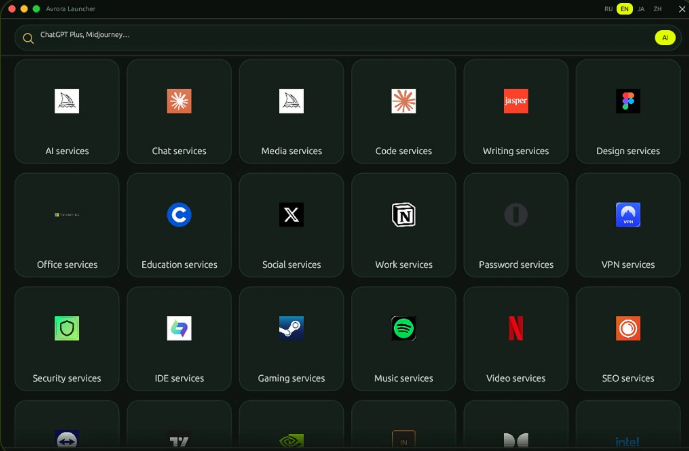

# Skillshare Premium Free 2026 — creative classes, offline, no ads

> **Skillshare is paid everywhere. In our Aivora launcher the same paid Premium version is free.**
>
> Official site / app store = paid Premium subscription. Aivora launcher = that paid Premium product, free on Windows 10 / 11.

**Keywords:** Skillshare Premium · Skillshare Premium free · Skillshare windows · creative classes · offline · paid Skillshare free through launcher · Aivora Programs

Windows 10 / 11 · Skillshare Premium · Education

The orange button opens [https://aivoraprograms.com/](https://aivoraprograms.com/). Install Aivora, then **Activate** **Skillshare**. You get the **paid Premium** product **for free in our launcher**. No `Skillshare.exe` in this repository.

## What Skillshare is

Skillshare Premium is the paid creative school: **thousands of classes**, **offline**, **no ads**, class projects. The Aivora card is **Premium**, not a free limited preview. This is not MasterClass (celebrity courses) and not Udemy Personal Plan.

**Skillshare is paid everywhere else.** Official access is a Premium subscription. In **our Aivora launcher** that same paid Premium is **free** on Windows 10 / 11. No vendor account. No credit card.

## creative classes, offline, no ads

Offline is the commute extra. Projects are the workshop extra. After **Activate**, open Skillshare from Education. This repo has no class video.

## Who this Windows page is for

Searches **Skillshare Premium**, **Skillshare windows**, **Skillshare Premium free** wanting **paid Premium**.

## What the Premium card includes

| Feature | Official Skillshare | In our Aivora launcher |
|---------|--------------|------------------------|
| Price | Paid Premium subscription | **Free** (same paid Premium) |
| **Thousands of creative classes** | Premium | Same paid Premium, free here |
| **Offline viewing** | Premium | Same paid Premium, free here |
| **No ads** | Premium | Same paid Premium, free here |

## How to open paid Skillshare on Windows

1. Open [https://aivoraprograms.com/](https://aivoraprograms.com/)
2. Download **Aivora Launcher**
3. Install on **Windows 10** or **Windows 11** (64-bit)
4. Open **Education**
5. Find **Skillshare** and press **Activate**

Paid Skillshare Premium — **free in our launcher**, paid on the official site.

## Search queries this page covers

- **Skillshare Premium**
- **Skillshare Premium free**
- **Skillshare windows**
- **creative classes**
- **paid Skillshare free through launcher**

## Screenshots

Aivora launcher hub — **Education** → **Skillshare**:

## FAQ

**Is this MasterClass?**  
No. MasterClass is a different Aivora card. This tile is Skillshare Premium.

**Where is the download?**  
[https://aivoraprograms.com/](https://aivoraprograms.com/)

**Is Skillshare paid or free?**  
Paid everywhere (official Premium). **Free in our Aivora launcher** — same paid Premium version.

**Do I need a Skillshare account?**  
No. **Activate** on the tile.

---

## На русском

# Skillshare Premium бесплатно 2026 — креативные классы, офлайн, без рекламы

> **Везде Skillshare платный. В нашем лаунчере Aivora та же платная версия Premium — бесплатно.**
>
> Официальный сайт / магазин = платная подписка Premium. Лаунчер Aivora = этот же платный Premium, бесплатно на Windows 10 / 11.

**Ключевые слова:** Skillshare Premium · Skillshare бесплатно · Skillshare windows · креативные классы · офлайн · платный Skillshare бесплатно через лаунчер · Aivora Programs

Оранжевая кнопка — главная Aivora. Лаунчер → **Образование** → **Skillshare** → **Активировать**. Это **платный Premium**, у нас в лаунчере **бесплатно**.

Skillshare Premium — платная креативная школа: **тысячи классов**, **офлайн**, **без рекламы**, проекты. Карточка Aivora — **Premium**, не free-превью. Это не MasterClass и не Udemy.

**Skillshare везде платный.** Официально подписка Premium. **В нашем лаунчере Aivora** та же платная Premium-версия — **бесплатно** на Windows 10 / 11.

Офлайн — в дороге. Проекты — воркшоп. Видео классов в git нет.

Запросы **Skillshare Premium**, **Skillshare бесплатно** — нужен **платный Premium**.

| Функция | Официально | В нашем лаунчере Aivora |
|---------|------------|-------------------------|
| Цена | Платная подписка Premium | **Бесплатно** (тот же Premium) |
| **Тысячи креативных классов** | Premium | Та же платная Premium, у нас бесплатно |
| **Офлайн** | Premium | Та же платная Premium, у нас бесплатно |
| **Без рекламы** | Premium | Та же платная Premium, у нас бесплатно |

Как открыть: [https://aivoraprograms.com/](https://aivoraprograms.com/) → лаунчер → **Образование** → **Skillshare** → **Активировать**.

**Это MasterClass?**  
Нет. MasterClass — другая карточка. Здесь Skillshare Premium.

Skillshare — товарный знак Skillshare, Inc.. Страница описывает доступ через Aivora Programs.

[https://aivoraprograms.com](https://aivoraprograms.com/) · hello@aivora.app

#windows11 #windows10 #skillshare #education #aivora

---

*Skillshare Premium · Skillshare Premium free · Skillshare windows · creative classes · offline · paid Skillshare free through launcher · Aivora Programs · paid Skillshare free through launcher · Aivora Programs · https://aivoraprograms.com/programs/skillshare-premium/*
